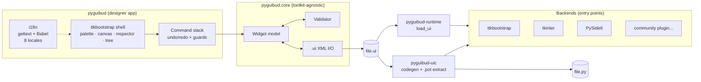
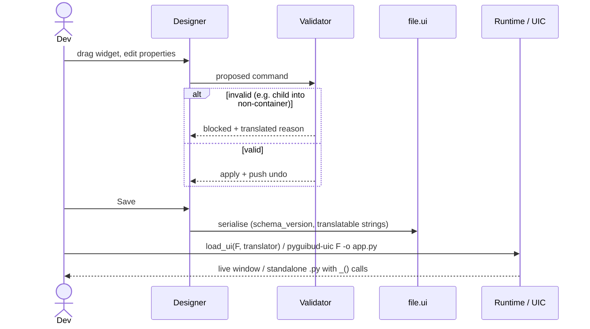
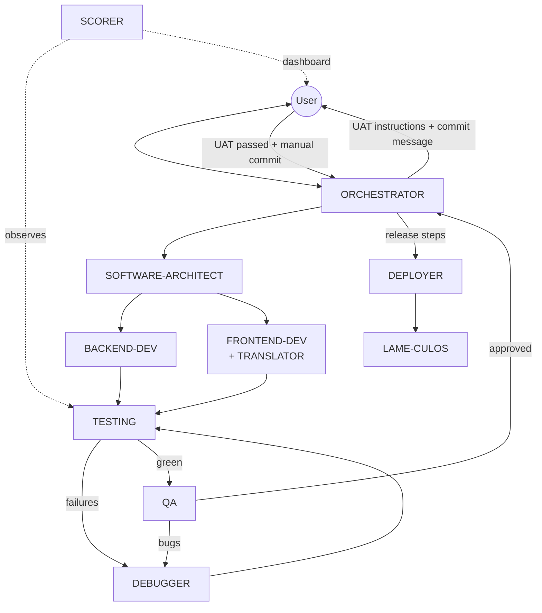
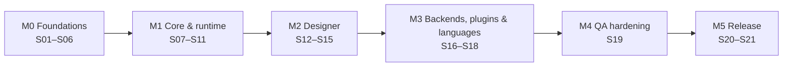

# PyGUIbud — Project Concept

> Drag-and-drop GUI designer for Python. Design once, save a `.ui` file, then **load it at runtime** or **export plain `.py`**.
> Backends: **ttkbootstrap** · tkinter · PySide6 · Languages: en-GB (source) + es-ES, pt-PT, pt-BR, de-DE, it-IT, nl-NL, fr-FR · Licence: **MIT** (+ [NOTICE](./NOTICE.md))
> v1 features: **[FEATURES.md](./FEATURES.md)** · ADRs: `docs/adr/`
> Full proposal (stack, licence, agents, steps, UAT): **[DEVELOPMENT_PLAN.md](./DEVELOPMENT_PLAN.md)**

## Scope

| In scope (v1) | Out of scope (v1) |
| --- | --- |
| Visual editor: palette, canvas, inspector, object tree | Full IDE / code editor |
| `.ui` XML file (versioned schema, translatable strings) | Binary/proprietary formats |
| Runtime loader `load_ui()`; code generator `pyguibud-uic` → standalone `.py` | Round-trip parsing of hand-edited `.py` |
| Backend plugins: ttkbootstrap, tkinter, PySide6 | Kivy, wx, Dear PyGui (welcome as community plugins/forks) |
| Multilingual designer **and** multilingual generated GUIs | Right-to-left scripts (later) |
| Idiot-proof editing: invalid actions are blocked | |

## 1. Architecture

## 2. `.ui` lifecycle

## 3. Agent orchestration and the user gate

## 4. Roadmap

## Brand
Copied from the SAPÉ corporate identity into `assets/brand/` (tokens, SVG logos, guidelines). Primary `#1C3FF0` (hover `#122AD2`, active `#1026A6`), background `#F8FAFC`, surface `#FFFFFF`, text `#212832`, semantic error/warning/success/info sets. Fonts: IBM Plex Sans (UI) and JetBrains Mono (code), all OFL.
