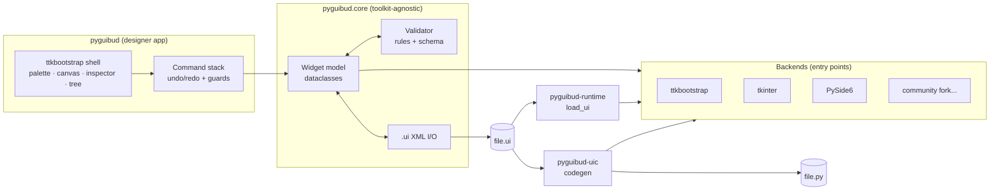
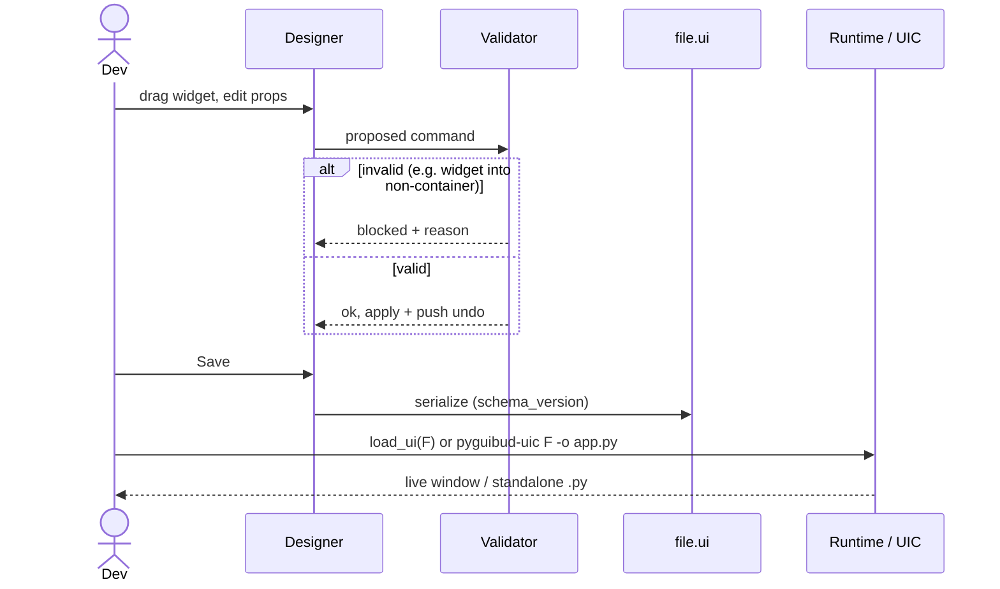
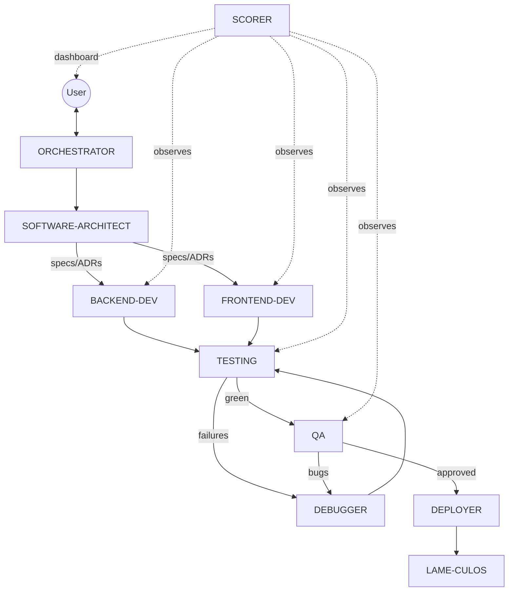
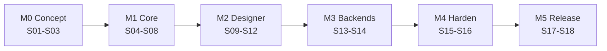

# PyGUIbud — Project Concept

> Drag-and-drop GUI designer for Python. Design once, save a `.ui` file, then **load it at runtime** or **export plain `.py`**. Targets **ttkbootstrap** first, **tkinter** and **PySide6** as backends.
> Status: **concept (Step 01)** · License: **MIT (proposed)** · Package: `pyguibud` (pip + uv)

---

## 1. Vision & scope

| In scope | Out of scope (v1) |
| --- | --- |
| Visual editor: palette → canvas → property inspector → object tree | Full IDE / code editor |
| `.ui` declarative file (XML, versioned schema) | Proprietary binary formats |
| Runtime loader: `load_ui("main.ui")` with zero PyGUIbud designer deps | Web/HTML targets |
| Code generator: `.ui` → standalone `.py` (no runtime dependency at all) | Round-trip parsing of hand-edited `.py` |
| Backends via plugins: ttkbootstrap · tkinter · PySide6 | Kivy, wx, Dear PyGui (welcome as **community forks/plugins**) |
| Idiot-proof editing: invalid actions are blocked, not just warned | |

## 2. Stack decision

| Layer | Choice | Why |
| --- | --- | --- |
| Language | Python ≥ 3.10 | Pattern matching, modern typing; covers all supported OSes |
| Designer UI | **ttkbootstrap** (dogfooding) | Light, pip-only, same toolkit we target first; no Qt license weight |
| Core model | Pure Python dataclasses, **toolkit-agnostic** | Backends never leak into the model, which keeps forks cheap |
| `.ui` format | XML + XSD/JSON-Schema validation, `schema_version` attr | Diff-friendly, Qt-familiar, stdlib `xml.etree` (no deps) |
| Extensibility | `importlib.metadata` **entry points** (`pyguibud.backends`, `pyguibud.widgets`) | Third parties add toolkits/widgets without touching core |
| Build/packaging | `pyproject.toml` + **hatchling**, managed with **uv**; extras `[pyside]`, `[dev]` | Works with both `pip install` and `uv add`/`uvx` |
| Quality | pytest (+ pytest-xvfb in CI), ruff, mypy --strict on core, pre-commit | Fast and standard, so contributors already know it |
| CI/CD | GitHub Actions matrix (Win/macOS/Linux × py3.10–3.13), trusted publishing to PyPI | Zero secrets in repo |
| Theming | SAPÉ tokens (`assets/brand/tokens`) → ttkbootstrap custom theme | Corporate look, still swappable |

**Package split** (one repo, two distributions):
- `pyguibud` — designer app + CLI (`pyguibud`, `pyguibud-uic`).
- `pyguibud-runtime` — tiny loader (stdlib + chosen toolkit only). This is what end users ship.

## 3. License

**MIT** (recommended). It is permissive and fork-friendly, and generated `.ui`/`.py` files belong 100% to the user. "Acceptable forks" are guided by `CONTRIBUTING.md` + a short **name/trademark note**: forks may not be published under the name "PyGUIbud" without consent, which keeps attribution clean. Alternative: Apache-2.0 if an explicit patent grant is wanted.
PySide6 is LGPL. Users import it dynamically from their own environment, so this is fine for MIT code.

## 4. Agents & models

Defined in `.claude/agents/*.md` (Step 03). Model is a **default**: the ORCHESTRATOR may up-/down-grade per task.

| Agent | Default model | Escalate / downgrade | Main tools |
| --- | --- | --- | --- |
| ORCHESTRATOR | user-selected | n/a | Agent, all; only one that talks to the user |
| SOFTWARE-ARCHITECT | opus | n/a | Read, Grep, Plan, writes ADRs |
| BACKEND-DEVELOPER | sonnet | opus: schema/codegen design · haiku: boilerplate | Edit, Bash, pytest |
| FRONTEND-DEVELOPER | sonnet | opus: DnD/canvas engine · haiku: styling | Edit, Bash, screenshots |
| DEBUGGER | opus | never downgrade | all |
| TESTING | sonnet | opus: flaky/GUI tests | pytest, computer control, screenshots |
| QA | opus | n/a | computer control, fuzzing (hypothesis), abuse scenarios |
| SCORER | haiku | sonnet: dashboard build | reads plan + test results → `SCOREBOARD.md` / HTML dashboard |
| DEPLOYER | sonnet | n/a | uv build, twine check, TestPyPI |
| LAME-CULOS (promoter) | sonnet | n/a | README, release notes, posts (user approves before publishing) |

## 5. Diagrams

### 5.1 Architecture

### 5.2 `.ui` lifecycle

### 5.3 Agent orchestration

### 5.4 Roadmap

## 6. Brand

Copied (not linked) from the SAPÉ corporate identity into `assets/brand/`: tokens (`tokens/*.json`), logos (`logo/*.svg`) and guidelines (`docs/`). Key UI tokens: primary `#1C3FF0` (hover `#122AD2`, active `#1026A6`), background `#F8FAFC`, surface `#FFFFFF`, neutral text `#212832`, plus error/warning/success/info sets. Fonts: IBM Plex Sans (UI), JetBrains Mono (code). All fonts are OFL.

See [DEVELOPMENT_PLAN.md](./DEVELOPMENT_PLAN.md) for the session-by-session plan.
